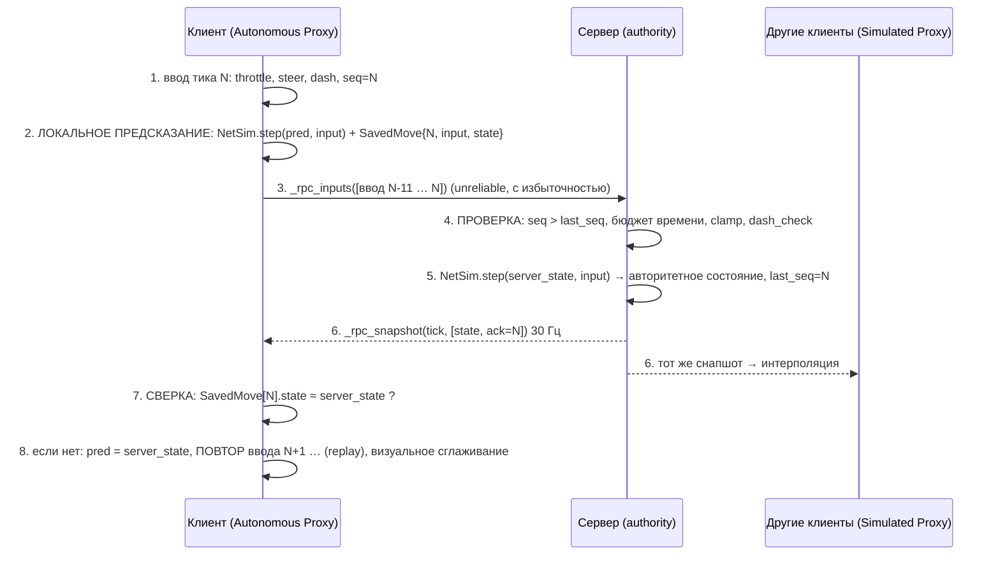
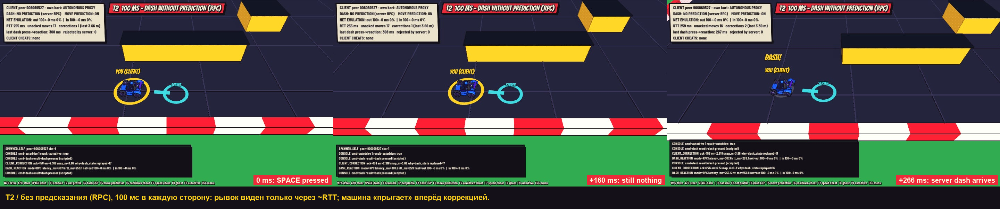
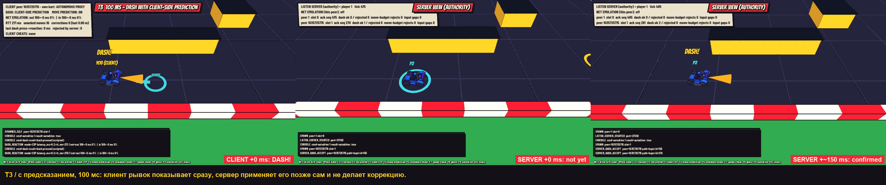
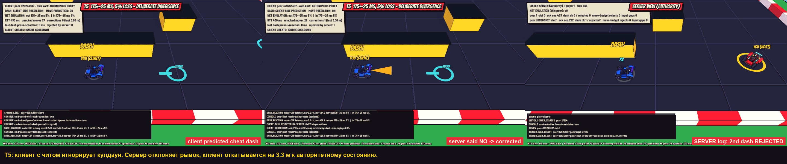
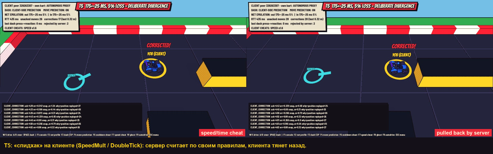

# Практическая работа №4 — Client-Side Prediction и Server Reconciliation

## 1. Общие сведения

| Поле | Значение |
|---|---|
| Проект | **Loop GP — NET LAB** (сетевой режим комикс-гонки на картах) |
| Состав команды | индивидуальная работа |
| Движок | **Godot Engine 4.4.1.stable.official (49a5bc7b6)**, GDScript — по согласованию с преподавателем вместо Unreal Engine (также GitHub вместо GitVerse) |
| Сетевой стек | Godot High-Level Multiplayer: `ENetMultiplayerPeer` (UDP) + `@rpc` |
| Топология | **Listen Server**: процесс-хост одновременно сервер и игрок 1, остальные подключаются как клиенты (2–8 игроков) |
| Коммит для демонстрации | `7148a16` (ветка `feature/prediction`) |
| Код | [`kart/scripts/net/`](../kart/scripts/net/) |
| Повторение опытов | [`kart/tools/netlab/run_prediction_tests.py`](../kart/tools/netlab/run_prediction_tests.py), логи — [`docs/prediction_logs/`](prediction_logs/) |
| Матрица тестов | [Prediction_Test_Matrix.md](Prediction_Test_Matrix.md) |

В Godot нет готового аналога `UCharacterMovementComponent` с сетевым предсказанием, поэтому его механизм (сохранённые ходы → `ServerMove` → `ClientAdjustPosition` → повторное проигрывание) реализован вручную и максимально близко к модели Unreal. Это и было основной работой: всё, что CMC делает «под капотом», здесь видно в коде.

### Соответствие ролей Unreal → проект

| Unreal | NET LAB | Что делает |
|---|---|---|
| `GameMode` (только сервер) | серверная часть [`net_lab.gd`](../kart/scripts/net/net_lab.gd): `_add_server_player`, `_server_tick_step`, `_server_apply` | создаёт игроков (`peer_connected`), выдаёт слот и точку спавна, применяет правила, принимает решения о рывке, рассылает снапшоты |
| `PlayerController` | `_sample_input()`, `_client_tick()` | читает клавиши (или автопилот), нумерует ввод, отправляет **намерение** на сервер, для варианта без CSP — дискретный RPC `_rpc_request_dash` |
| `Character` | `NetSim.State` + [`NetKartView`](../kart/scripts/net/net_kart_view.gd) | реплицируемое состояние карта (позиция, курс, скорость, рывок, кулдаун) и его отображение; действие «рывок» |
| `CharacterMovementComponent` | [`net_sim.gd`](../kart/scripts/net/net_sim.gd) `NetSim.step()` + сохранённые ходы и `_reconcile()` в `net_lab.gd` | одна детерминированная функция движения для клиента и сервера, Saved Moves, серверная проверка, коррекция, replay |
| Autonomous Proxy | свой карт на клиенте | предсказывается сразу, сверяется с сервером |
| Simulated Proxy | чужие карты на клиенте | интерполируются по снапшотам на 100 мс в прошлом |
| Network Emulation | [`net_emu.gd`](../kart/scripts/net/net_emu.gd) | `NetEmulation.PktLag/PktLagVariance/PktLoss/PktIncoming*` — те же имена, что в UE |

## 2. Поток данных



| Шаг | Где в коде | Что передаётся / проверяется |
|---|---|---|
| Ввод клиента | `_sample_input()` [`net_lab.gd:299`](../kart/scripts/net/net_lab.gd#L299) | `Cmd{seq, throttle, steer, dash}` — только намерение |
| Локальное предсказание | `_client_tick()` [`net_lab.gd:488`](../kart/scripts/net/net_lab.gd#L488) → `NetSim.step()` [`net_sim.gd:126`](../kart/scripts/net/net_sim.gd#L126) | шаг сразу, без ожидания, ход кладётся в `_saved` |
| Отправка | `_send(1, "_rpc_inputs", …)` | последние 12 неподтверждённых вводов в каждом пакете (как CMC повторяет старые ходы) |
| Серверная проверка | `_srv_on_inputs()` [`net_lab.gd:444`](../kart/scripts/net/net_lab.gd#L444), `_server_apply()` [`net_lab.gd:388`](../kart/scripts/net/net_lab.gd#L388) | порядок seq, дубликаты, бюджет времени, диапазоны, правила рывка |
| Репликация | `_broadcast_snapshot()` [`net_lab.gd:419`](../kart/scripts/net/net_lab.gd#L419) | `[tick, [peer, slot, state, last_seq]…]`, 30 Гц |
| Коррекция + replay | `_reconcile()` [`net_lab.gd:583`](../kart/scripts/net/net_lab.gd#L583) | сравнение с сохранённым ходом `ack`, откат, повторное применение ходов `> ack` |
| Чужие карты | `_render_client()` / `_interp()` [`net_lab.gd:667`](../kart/scripts/net/net_lab.gd#L667) | буфер снапшотов, отрисовка на 6 тиков (100 мс) в прошлом |

Клиент **никогда** не отправляет координаты. Сервер не имеет кода, который записывает позицию, полученную от клиента: позиция меняется только внутри `NetSim.step()` на сервере.

## 3. Роли в проекте подробнее

- **GameMode (сервер).** На `peer_connected` создаёт `ServerPlayer` со своим `NetSim.State`, номером слота, бюджетом ходов и счётчиками. Каждые 1/60 с (`_server_tick_step`) пополняет бюджет, симулирует карт хоста, раз в 2 тика рассылает снапшот. На `peer_disconnected` удаляет игрока — остальные клиенты видят исчезновение карта.
- **PlayerController.** Собирает ввод с клавиатуры/геймпада (`W/S`, `A/D`, `SPACE`) или от автопилота для воспроизводимых опытов; одно нажатие = один запрос рывка (защита от автоповтора). Есть Unreal-подобная консоль (`F1`) и горячие клавиши `F2…F9`.
- **Character.** Состояние: `pos`, `heading`, `speed`, `dash_ticks`, `cooldown_ticks`. `NetKartView` только рисует состояние: модель карта, пламя рывка, кольцо кулдауна, подписи «DASH!», «CORRECTED!», «REJECTED». Голубое кольцо `SERVER` — последнее авторитетное положение своего карта (призрак).
- **CharacterMovementComponent.** `NetSim.step()` — детерминированная функция без обращения к движку физики: одна и та же на клиенте и сервере (60 тиков/с, фиксированный `DT`). Рывок встроен в этот же шаг как флаг ввода — так же, как в UE кастомные флаги добавляют в `FSavedMove` (`GetCompressedFlags`), поэтому рывок тоже предсказывается и переигрывается.

## 4. Действие «рывок» (dash) и серверные проверки

Рывок: 0.2 с (12 тиков) скорость 34 м/с вперёд, затем кулдаун 1.5 с (90 тиков). Рывок в препятствие обрывается (коллизии считаются в той же функции).

| Проверка на сервере | Где | Что будет при нарушении |
|---|---|---|
| кулдаун истёк (`cooldown_ticks == 0`) | `NetSim.dash_check()` [`net_sim.gd:112`](../kart/scripts/net/net_sim.gd#L112) | рывок отклонён, `server_dash_reject why=cooldown`, клиенту — `_rpc_dash_result`, состояние без рывка уходит в снапшоте → коррекция |
| сейчас не идёт другой рывок | там же | `already_dashing` |
| карт уже едет вперёд ≥ 3 м/с | там же | `too_slow` |
| направление рывка = текущий курс **на сервере** | `NetSim.step()` | клиент не может задать направление/дальность |
| `seq` строго растёт, дубликаты игнорируются | `_srv_on_inputs()` | повтор пакета не даёт лишних ходов |
| бюджет времени: не больше ходов, чем прошло реального времени (+0.3 с запас) | `_server_apply()` | ход подтверждается, но **не симулируется** (`server_reject_move why=move_budget`) — защита от спидхака |
| `throttle`, `steer` ∈ [-1; 1], NaN → 0 | `NetSim.Cmd.from_array()` | нельзя «разогнаться» вводом 100 |
| коллизии со стенами и колоннами | `NetSim._collide()` | рывок сквозь стену невозможен |

## 5. Сравнение: без предсказания и с ним

Режим переключается `F3` / `net.DashPrediction 0|1` / `--csp=0|1`.

| | Без локального предсказания (T2) | С CSP (T3) |
|---|---|---|
| Как запускается рывок | отдельный **reliable RPC** `_rpc_request_dash`; локально ничего не происходит | флаг `dash` в обычном вводе; клиент применяет сразу, сервер — когда ввод дойдёт |
| Что видно игроку | ~RTT ничего, затем коррекция «дёргает» карт вперёд (рывок на сервере уже закончился, т.к. 200 мс < RTT) | рывок в том же кадре |
| Задержка нажатие → реакция (100 мс в каждую сторону, RTT ≈ 266 мс) | **293.3 мс** в среднем (266.6–311.8, n=6) | **0.2 мс** (n=6, т.е. тот же тик) |
| То же при 175±25 мс и 5% потерь (T4) | **694.5 мс** (428–1174, n=3; 1174 — потерянный RPC пришёл повторной передачей) | **0.2 мс** (n=6) |
| Коррекции | 1 на каждый рывок (`why=dash_state`, ~3.3–3.7 м) | **0** — предсказание совпало с сервером |
| Авторитетность | сервер решает | сервер решает так же — честный клиент просто заранее знает ответ |

RTT в HUD больше, чем 2×100 мс, на ~60 мс: эмулятор и ENet обслуживаются раз в кадр (60 FPS, ~16 мс на каждом переходе), это видно и в T1 (RTT ≈ 41 мс без эмуляции).

Медиа: [baseline_no_prediction.mp4](media/baseline_no_prediction.mp4) / [.png](media/baseline_no_prediction.png), [prediction_enabled.mp4](media/prediction_enabled.mp4) / [.png](media/prediction_enabled.png). Видео — слева окно клиента, справа окно сервера (камера сервера следит за картом клиента).

| Ролик | Длительность | Ключевые моменты |
|---|---|---|
| `baseline_no_prediction.mp4` | 15 с | нажатия на 2.5, 4.5, 6.5 … с после спавна; в HUD «last dash press→reaction ≈ 300 ms», карт «прыгает» через ~0.3 с |
| `prediction_enabled.mp4` | 15 с | те же моменты; «DASH!» и пламя сразу на клиенте, на сервере — на ~150 мс позже, `corrections 0` |
| `correction_example.mp4` | 18 с | 3.0–4.0 с: чит «игнор кулдауна», надпись `REJECTED: COOLDOWN`, `CORRECTED!`, откат на 3.3 м; 7–10 с: `SpeedMult 1.6` — постоянное подтягивание назад; 11.5–13.5 с: `DoubleTick` — сервер режет лишние ходы |




## 6. Намеренное расхождение и серверная коррекция (T5)

Профиль 175±25 мс, 5% потерь в обе стороны. Клиентские «читы» существуют только для демонстрации и **не влияют на сервер**:

1. `cheat.IgnoreCooldown 1` — клиент предсказывает рывок, игнорируя кулдаун (аналог «временно изменить параметр на клиенте»). Сервер: `server_dash_reject why=cooldown cooldown_left_ms≈1000`. Клиент получает снапшот без рывка → `client_correction why=dash_state snap_m=3.3 replayed≈24` → карт возвращается к авторитетному результату и продолжает ехать. Подпись `REJECTED: COOLDOWN`.
2. `cheat.SpeedMult 1.6` — клиент считает себя быстрее. Каждый снапшот даёт небольшую коррекцию: карт «тянет» назад, расхождение не накапливается.
3. `cheat.DoubleTick 1` — клиент шлёт два хода за тик (спидхак по времени). Сервер отклонил **91** ход по бюджету, клиент откатывался до 3.9 м.

Итог T5: 73 коррекции, 2 из 4 рывков отклонены, соединение не разорвано, после выключения читов коррекции прекращаются.




Видео: [correction_example.mp4](media/correction_example.mp4).

## 7. Эмуляция сети

Эмулятор на каждом пире, задерживает/теряет сообщения до вызова `rpc_id` и после получения. Reliable-сообщения не теряются, а приходят на `2×(lag_out+lag_in)+50` мс позже (как повторная передача).

```text
# профиль 1 (T2, T3)                 # профиль 2 (T4, T5)
NetEmulation.PktLag 100              NetEmulation.PktLag 175
NetEmulation.PktLagVariance 0        NetEmulation.PktLagVariance 25
NetEmulation.PktLoss 0               NetEmulation.PktLoss 5
NetEmulation.PktIncomingLag 100      NetEmulation.PktIncomingLag 175
NetEmulation.PktIncomingLagVariance 0  NetEmulation.PktIncomingLagVariance 25
NetEmulation.PktIncomingLoss 0       NetEmulation.PktIncomingLoss 5
```

Эмуляция включается на клиенте (`--profile=N`, `F2`, или команды выше в консоли `F1`); `NetEmulation.Off` / `net.Profile 0` выключает её перед чистовой демонстрацией. Фактически потеряно в T4: 68 из 1279 исходящих (5.3%) и 38 входящих снапшотов.

## 8. Запуск

```powershell
# сервер (listen server, игрок 1)
Godot_v4.4.1-stable_win64.exe --path kart -- --netlab --host
# клиент (второе окно), задержка 100 мс, без предсказания рывка
Godot_v4.4.1-stable_win64.exe --path kart -- --netlab --client --ip=127.0.0.1 --profile=1 --csp=0
# все опыты T1–T5 с логами и видео
python kart/tools/netlab/run_prediction_tests.py --godot C:/…/Godot_v4.4.1-stable_win64.exe --frames C:/tmp/frames
python kart/tools/netlab/make_media.py --frames C:/tmp/frames
```

Из меню игры: **NET LAB (MULTIPLAYER)** → `HOST` / `JOIN`.

## 9. Известные ограничения

- Карты не сталкиваются друг с другом (только со стенами и колоннами): столкновение с чужим картом, который клиент видит в прошлом, само по себе даёт расхождения; оставлено вне объёма работы.
- Детерминизм `NetSim.step()` проверен на одной машине; на разных CPU/сборках float может давать мелкие расхождения — их исправит та же коррекция (порог 0.02).
- Сервер симулирует ход клиента при получении ввода (как `ServerMove` в UE), без экстраполяции: при долгой потере связи карт на сервере стоит.
- Эмулятор работает на уровне игровых сообщений, а не UDP-пакетов, и обслуживается раз в кадр (+~16 мс на переход).
- Без предсказания рывок длиной 200 мс короче RTT, поэтому клиент видит не сам рывок, а его результат (скачок вперёд) — это и есть демонстрируемая проблема.
- Хост (listen server) играет без задержки — у него нет сети до сервера; это свойство топологии Listen Server.
