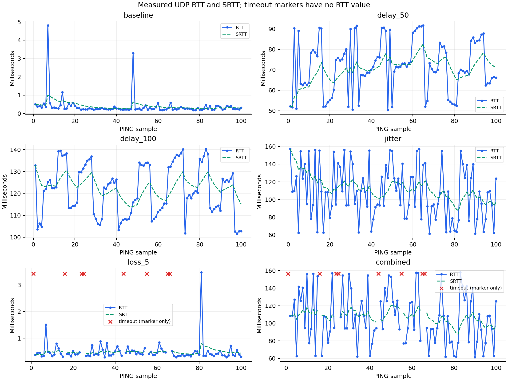

# Практическая работа №2: измерение RTT и качества UDP-соединения

## Автор

Работа выполнена индивидуально. Автор: [aaackermannn](https://gitverse.ru/aaackermannn). Проект: Loop.

## Методика и архитектура

Реализован C++17-клиент и dedicated-сервер из учебного шаблона. `protocol` сериализует каждое поле явно в big-endian и проверяет входные данные; `transport` работает только с UDP/IPv4 и ошибками сокета; `telemetry` получает время аргументом и считает состояния/метрики без сети и файлов. Точки входа соединяют эти модули, задают расписание и журналируют события.

Клиент и сервер запущены разными процессами на одном Windows-ПК по 127.0.0.1:27015. Проведены шесть серий по 50 PING с интервалом 500 мс. Тайм-аут — 1000 мс, дополнительное окно приёма — 1200 мс. В сервер встроен эмулятор: очередь задержанных PONG и вероятностный пропуск ответов. Измеряется локальный UDP с искусственной серверной задержкой.

Все параметры и воспроизведение — в [Experiment_Config.md](Experiment_Config.md); реальные исходные данные — в [CSV](latency_samples.csv), [manifest](experiment_manifest.json) и [логах](experiment_logs/). Неуспешные ответы не заменяются синтетическими RTT.

Формулы:

```text
RTT_ms = (client_receive_us - saved_client_send_us) / 1000
SRTT_1 = RTT_1
SRTT_i = 0.875*SRTT_(i-1) + 0.125*RTT_i
J = sum(abs(RTT_i - RTT_(i-1))) / (n-1)
LossRate = 100*N_timeout / N_sent
```

SRTT и J обновляются в порядке приёма уникальных своевременных ответов. При n<2 J=0; если нет успешных ответов, RTT-статистика/SRTT отсутствуют. Серверные метки диагностические: для RTT используются только клиентские монотонные часы. Разность серверных меток показывает прикладное ожидание/обработку на сервере, не требует синхронизации часов и не вычитается из RTT.

В реестре измерений состояния Pending/Received/TimedOut/LateReceived различаются явно. Дубликат не добавляет измерение; поздний ответ не отменяет тайм-аут. Неизвестный номер, чужой отправитель, неверная метка или датаграмма не меняют успешную статистику. Дополнительные строки событий в CSV не увеличивают число отправленных PING. Подробности и диаграмма — в [спецификации](Protocol_Specification.md).

## Результаты

Таблица ниже автоматически получена независимым анализатором из CSV и сверена с итогами C++-клиента. Received означает ответ в пределах дедлайна; late входит в timeout, а не прибавляется к sent повторно.

<!-- metrics:start -->
| Серия | Отправлено | Получено | Тайм-ауты | Late | Min, мс | Mean, мс | Median, мс | Max, мс | SRTT, мс | Jitter, мс | Loss, % |
|---|---:|---:|---:|---:|---:|---:|---:|---:|---:|---:|---:|
| baseline | 50 | 50 | 0 | 0 | 0.185 | 0.387 | 0.294 | 4.199 | 0.281 | 0.239 | 0.000 |
| delay_50 | 50 | 50 | 0 | 0 | 58.326 | 62.237 | 62.306 | 64.034 | 61.947 | 0.831 | 0.000 |
| delay_100 | 50 | 50 | 0 | 0 | 106.776 | 109.005 | 109.077 | 111.134 | 109.452 | 1.104 | 0.000 |
| jitter | 50 | 50 | 0 | 0 | 61.867 | 112.763 | 108.910 | 158.032 | 120.034 | 36.538 | 0.000 |
| loss_5 | 50 | 47 | 3 | 0 | 0.158 | 0.304 | 0.269 | 0.926 | 0.284 | 0.124 | 6.000 |
| combined | 50 | 47 | 3 | 0 | 61.858 | 113.363 | 109.044 | 157.083 | 119.835 | 34.239 | 6.000 |
<!-- metrics:end -->

Всего отправлено 300 PING, получено вовремя 294, тайм-аутов 6. Во всех шести сериях поздние, повторные, неизвестные и невалидные ответы отсутствовали; соответствующие ветви проверены отдельно управляемыми UDP-тестами, а не объявлены проверенными на основании этих шести серий.

## Графики



Рисунок 1. Линии RTT/SRTT; красный крест — событие timeout, его высота на панели не является RTT. На потерянных измерениях линии разорваны. Панели имеют разные диапазоны оси Y для видимости колебаний.


Рисунок 2. Mean RTT и итоговый SRTT в миллисекундах, потери на отдельной панели в процентах.


Рисунок 3. Box plot только успешных RTT: медиана — линия, среднее — треугольник, коробка — межквартильный диапазон, усы — стандартное правило 1.5 IQR, отдельные точки — выбросы. Для каждой серии подписаны n и потери.

## Анализ

1. **Baseline.** Средний RTT 0.387 мс, медиана 0.294 мс; единичный максимум 4.199 мс повышает среднее. SRTT после выброса возвращается к типичным значениям и заканчивает на 0.281 мс. Это локальный прикладной RTT, а не оценка задержки внешней сети.
2. **Постоянная задержка.** При заданных 50/100 мс средние RTT получились 62.237/109.005 мс. По серверным меткам среднее время обработки/ожидания равно 61.921/108.687 мс, остаток RTT около 0.3 мс. Значит, большая часть превышения заданной задержки находится внутри серверного ожидания. Дискретность select и планирование Windows являются правдоподобным объяснением; отдельное профилирование планировщика не выполнялось. Измерения не подгонялись под ровные 50/100 мс.
3. **Джиттер.** Диапазон успешных RTT примерно 61.867..158.032 мс; J вырос до 36.538 мс против 0.239 мс в baseline. SRTT значительно плавнее RTT, но реагирует с запаздыванием и не обязан совпадать с общим средним. Итоговый SRTT 120.034 мс отражает последние измерения сильнее ранних.
4. **Потери.** В loss_5 исчезли 3 ответа из 50 — 6%. При вероятности 0.05 математическое ожидание 2.5 пропуска, но наблюдаемый счётчик целый. Отклонение от 5% на малой выборке ожидаемо; при фиксированном seed решения повторяются. Отсутствующие ответы исключены из RTT-метрик, но включены в LossRate.
5. **Combined.** Получено 47 ответов, 3 тайм-аута, mean RTT 113.363 мс, J 34.239 мс. Профиль задаёт 100 мс плюс отклонение −50..+50 мс и пропуски 5% PONG. Похожесть с jitter связана с одинаковым seed и общей последовательностью решений. После потери соседними для J считаются соседние успешные ответы, поэтому изменение J не означает улучшения качества связи.

Средние интервалы отправки задавались независимо от получения ответов. Фактические интервалы по всем сериям примерно 485..514 мс вокруг целевых 500 мс: обычный планировщик не обеспечивает точного real-time. Нет накопления паузы «ожидание ответа + 500 мс», свойственного блокирующему клиенту ПР №1.

## Проверка корректности

На Windows/MSVC прошли Debug и Release: 15 Catch2 test cases, включая 149327 проверок, отдельные Python-тесты анализа CSV и реальные UDP-тесты. Проверяются эталонные big-endian байты, все длины усечения, все неверные значения payloadSize, ошибки версии/типа, сохранность выходного заголовка при ошибке, числовые границы, median/SRTT/jitter/loss и отсутствие данных.

Контролируемые UDP-проверки вызывают неверную версию, неверную echoed-метку, чужой endpoint, unknown, два вида duplicate, late после Expire, перестановку PONG, отсутствие сервера и повреждённые входные пакеты сервера. Проверяется постоянство расписания с допустимым отклонением, корректные counts, отсутствие RTT у timeout и отсутствие двойного terminal outcome. CTest ограничивает длительность интеграционной проверки. Синтетические RTT 100/120/80 используются исключительно в unit-тесте, а не в экспериментальном CSV.

## Ограничения и вывод

Один ПК, loopback и 50 проб на серию не позволяют делать выводы о региональном ping, NAT, реальной потере датаграмм по маршруту или многопользовательской нагрузке. Задержка — часть серверной обработки. Seed фиксирует решения эмулятора, но ОС добавляет невоспроизводимые до микросекунды колебания. Серии с общим seed не являются независимыми случайными повторениями. Локально проверена Windows-сборка; POSIX-ветвь требует отдельного запуска.

Подсистема измеряет RTT/SRTT/jitter и потери по дедлайну, изолирует расчёты от сокетов и корректно обрабатывает пограничные ответы. CSV позволяет независимо восстановить статистику. Для ПР №3 доступны измерения SRTT и явный жизненный цикл, но ACK, повторные отправки и алгоритм RTO здесь не реализованы.
