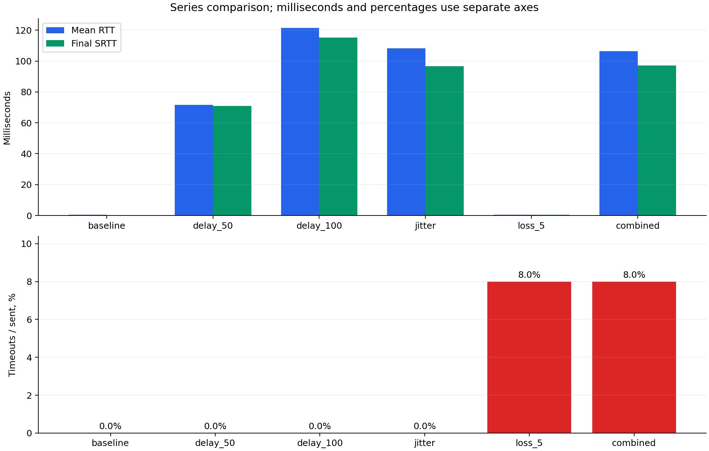
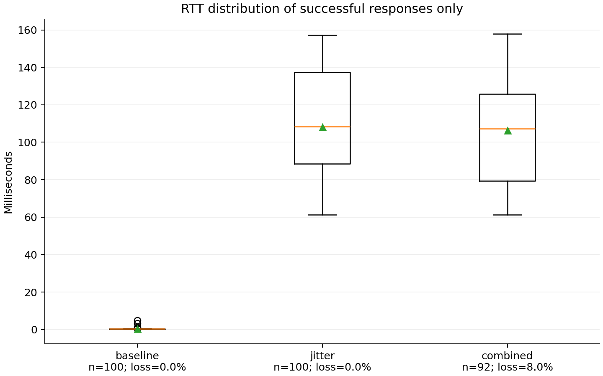

# Практическая работа №2: измерение RTT и качества UDP-соединения

## Автор

Работа выполнена индивидуально. Автор: [aaackermannn](https://gitverse.ru/aaackermannn). Проект: Loop.

## Методика и архитектура

Реализован C++17-клиент и dedicated-сервер из учебного шаблона. `protocol` сериализует каждое поле явно в big-endian и проверяет входные данные; `transport` работает только с UDP/IPv4 и ошибками сокета; `telemetry` получает время аргументом и считает состояния/метрики без сети и файлов. Точки входа соединяют эти модули, задают расписание и журналируют события.

Клиент и сервер запущены разными процессами на одном Windows-ПК по 127.0.0.1:27015. Проведены шесть серий по 100 PING с интервалом 200 мс. Тайм-аут — 1000 мс, дополнительное окно приёма — 1200 мс. Clumsy 0.3 задаёт постоянные задержки 50/100 мс и пропуски 5% исходящих PONG. В jitter и combined переменная задержка 50..150 мс реализована очередью сервера; это явно выделенная часть смешанного стенда.

Все параметры и воспроизведение — в [Experiment_Config.md](Experiment_Config.md); реальные исходные данные — в [CSV](latency_samples.csv), [manifest](experiment_manifest.json) и [логах](experiment_logs/). Неуспешные ответы не заменяются синтетическими RTT.

Формулы:

```text
RTT_ms = (client_receive_us - saved_client_send_us) / 1000
SRTT_1 = RTT_1
SRTT_i = 0.875*SRTT_(i-1) + 0.125*RTT_i
J = sum(abs(RTT_i - RTT_(i-1))) / (n-1)
LossRate = 100*N_timeout / N_sent
```

SRTT и J обновляются в порядке приёма уникальных своевременных ответов. При n<2 J=0; если нет успешных ответов, RTT-статистика/SRTT отсутствуют. Серверные метки диагностические: для RTT используются только клиентские монотонные часы. Разность серверных меток показывает прикладное ожидание/обработку на сервере, не требует синхронизации часов и не вычитается из RTT.

В реестре измерений состояния Pending/Received/TimedOut/LateReceived различаются явно. Дубликат не добавляет измерение; поздний ответ не отменяет тайм-аут. Неизвестный номер, чужой отправитель, неверная метка или датаграмма не меняют успешную статистику. Дополнительные строки событий в CSV не увеличивают число отправленных PING. Подробности и диаграмма — в [спецификации](Protocol_Specification.md).

## Результаты

Таблица автоматически рассчитана по CSV и сверена с summary клиента. Всего 600 PING, 584 своевременных ответов, 16 тайм-аутов. Late не считается отдельной отправкой и не отменяет timeout.

<!-- metrics:start -->
| Серия | Отправлено | Получено | Тайм-ауты | Late | Min, мс | Mean, мс | Median, мс | Max, мс | SRTT, мс | Jitter, мс | Loss, % |
|---|---:|---:|---:|---:|---:|---:|---:|---:|---:|---:|---:|
| baseline | 100 | 100 | 0 | 0 | 0.186 | 0.387 | 0.269 | 4.814 | 0.301 | 0.242 | 0.000 |
| delay_50 | 100 | 100 | 0 | 0 | 50.297 | 71.694 | 71.379 | 91.746 | 71.023 | 8.321 | 0.000 |
| delay_100 | 100 | 100 | 0 | 0 | 101.625 | 121.542 | 122.028 | 140.344 | 115.103 | 4.744 | 0.000 |
| jitter | 100 | 100 | 0 | 0 | 61.350 | 108.247 | 108.258 | 157.274 | 96.755 | 33.569 | 0.000 |
| loss_5 | 100 | 92 | 8 | 0 | 0.285 | 0.489 | 0.404 | 3.473 | 0.439 | 0.216 | 8.000 |
| combined | 100 | 92 | 8 | 0 | 61.309 | 106.334 | 107.192 | 157.922 | 97.122 | 32.726 | 8.000 |
<!-- metrics:end -->


Рисунок 1. RTT и SRTT; красный крест отмечает номер timeout без выдуманного RTT. Положение креста по вертикали условное.



Рисунок 2. Средний RTT и итоговый SRTT (мс); доля timeout вынесена на отдельную ось в процентах.



Рисунок 3. Baseline, jitter и combined: медиана, среднее (треугольник), квартильный диапазон, усы 1.5 IQR и выбросы. Указаны количество успешных ответов и потери.

## Анализ

1. Baseline: mean 0.387 мс, median 0.269 мс. Это прикладной RTT loopback на одном ПК.
2. При Lag 50/100 мс средний RTT составил 71.694/121.542 мс. Время больше настройки эмулятора: к Lag добавляются проход через фильтр, обработка и планирование Windows. Калибровочные PING подтвердили действие задержки. Отдельно вклад каждого источника накладных расходов не измерялся.
3. Jitter: RTT 61.350..157.274 мс; J=33.569 мс против 0.242 мс в baseline. Переменная задержка задана сервером. SRTT сглаживает колебания, но сильнее зависит от последних ответов, чем общее среднее.
4. Loss_5: Clumsy отбросил ответы так, что клиент зафиксировал 8/100=8.0% timeout. Настройка 5% означает вероятность, а не ровно пять пропусков. Отсутствующие ответы исключены из RTT, но включены в LossRate.
5. Combined: mean 106.334 мс, J=32.726 мс, timeout 8/100=8.0%. Сервер задаёт 100±50 мс, Clumsy — Drop 5%. Для J берутся соседние успешные ответы; после потери набор соседних пар меняется. Одинаковый серверный seed связывает последовательности jitter и combined.

Отправки планируются независимо от приёма. Пауза ожидания ответа не добавляется к заданным 200 мс. Обычная ОС допускает колебания фактических интервалов; точного real-time расписания не предполагается. Серверные логи сохраняют все принятые PING; в loss_5/combined они отправляют PONG, а пропуски происходят далее в Clumsy.

## Проверка корректности

Debug и Release: CTest 3/3. Catch2: 15 cases, 149327 assertions; Python-тесты анализа CSV; шесть реальных UDP-сценариев. Также проверена сборка опубликованного GitVerse-кода в отдельной копии. Проверяются big-endian байты, усечённые пакеты, неверные тип/версия/длина, числовые границы, median/SRTT/jitter/loss и отсутствие данных.

UDP-тесты проверяют чужой endpoint, echoed timestamp, unknown/duplicate/late, перестановку PONG, отсутствие сервера, повреждённый запрос, обратные метки serverSendTimeUs < serverReceiveTimeUs и сохранность CSV при повторном run_id. Некорректный PONG не завершает активное измерение. Замечания и исправления оформлены в [саморевью](Code_Review.md) и PR. Python обязателен при BUILD_TESTING=ON.

## Ограничения и вывод

Один ПК и loopback не моделируют маршрут через интернет, NAT и многопользовательскую нагрузку. В jitter/combined задержка встроена в сервер. Clumsy не предоставляет фиксируемого извне seed; повторяется конфигурация, а не побитная последовательность потерь и RTT. Windows добавляет колебания планировщика. POSIX-ветвь требует отдельной проверки на Linux.

RTT, SRTT, jitter и потери по дедлайну измеряются независимо от сетевого ввода и сериализации. CSV позволяет восстановить статистику; графики построены по реальным измерениям. Работа индивидуальная: опубликовано саморевью, внешнего одобрения нет. ACK, повторные отправки и адаптивный RTO выходят за рамки этой работы.
