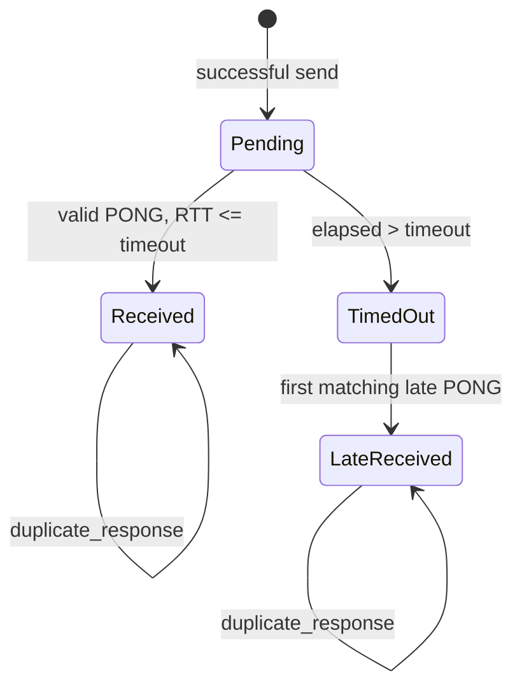

# Спецификация протокола ПР №3

UDP/IPv4, версия 2. Одна датаграмма содержит один пакет. ПР №3 добавляет байт `requiresAck` к формату ПР №2 и требует обновления обеих сторон. Исходный прототип Loop из ПР №1 использует отдельный двоичный формат. Поля игровых команд этого прототипа используются и в ПР №3.

## Заголовок

| Смещение | Поле | Тип | Размер | Назначение |
|---:|---|---|---:|---|
| 0 | packetType | uint8_t | 1 | 1 PING, 2 PONG, 3 MOVEMENT, 4 SHOOT, 5 ACK |
| 1 | sequenceNumber | uint16_t | 2 | Номер измерения или команды, в ответе копируется из запроса |
| 3 | payloadSize | uint16_t | 2 | Размер только полезной нагрузки |
| 5 | protocolVersion | uint16_t | 2 | Всегда 2 |
| 7 | requiresAck | uint8_t | 1 | 1 у SHOOT, 0 у остальных типов |

Заголовок занимает 8 байт. Многобайтовые поля передаются в порядке big-endian. `PacketHeader` представляет данные в памяти. Сериализатор записывает каждое поле отдельно, поэтому размер структуры и выравнивание в C++ не влияют на формат датаграммы. Разбор проверяет границы буфера перед чтением заголовка и полезной нагрузки.

## PING и PONG

PING (клиент → сервер) занимает 16 байт, из них 8 байт полезной нагрузки для `clientSendTimeUs:uint64_t`.

PONG (сервер → клиент) занимает 32 байта, из них 24 байта полезной нагрузки для `clientSendTimeUs`, `serverReceiveTimeUs`, `serverSendTimeUs`. Каждое поле имеет тип `uint64_t`. Номер и `clientSendTimeUs` повторяют исходный PING. Обе датаграммы имеют `requiresAck=0`.

Метки измеряются в микросекундах источником `std::chrono::steady_clock`. Клиент берёт метку перед сериализацией/отправкой и сохраняет её после успешного sendto. RTT включает сериализацию, системные вызовы, обработку и ожидание на сервере; это прикладное RTT. Сервер ставит receive-метку после recvfrom, send-метку перед сериализацией фактически отправляемого PONG. Часы разных машин не синхронизируются.

`RTT_ms = (clientReceiveUs − savedClientSendUs) / 1000`. Межмашинные разности времени запрещены: серверные метки используются только для диагностического `serverSendUs − serverReceiveUs`. Клиент дополнительно проверяет монотонный порядок серверных меток.

Датаграмма PING с номером `0x1234` и меткой `0x0102030405060708` в шестнадцатеричном виде.

```text
01 12 34 00 08 00 02 00 01 02 03 04 05 06 07 08
```

## Игровые команды и подтверждение

| Тип и направление | Нагрузка в порядке записи | Общий размер |
|---|---|---:|
| MOVEMENT, клиент → сервер | `x` и `y` — координаты карта, по 4 байта | 16 байт |
| SHOOT, клиент → сервер | `dirX` и `dirY` — компоненты направления, по 4 байта. Затем `weaponId:uint32_t` | 20 байт |
| ACK, сервер → клиент | `acknowledgedSequence:uint16_t` — номер принятой команды SHOOT | 10 байт |

Координаты и компоненты направления используют IEEE 754 binary32. Сериализатор копирует биты значения в целое `uint32_t` и записывает его старшим байтом вперёд. Поля нагрузки следуют терминологии Loop из ПР №1.

SHOOT — отдельное применение предмета. При тайм-ауте клиент отправляет исходные байты с тем же номером. Сервер подтверждает и первый приём, и повтор. Окно дедупликации ограничивает применение игрового эффекта одним разом. ACK подтверждает доставку команды и не сообщает исход применения предмета. Его заголовок и поле `acknowledgedSequence` повторяют один и тот же номер исходного SHOOT. Поскольку `requiresAck=0`, получатель не отправляет ACK в ответ на ACK.

MOVEMENT передаёт текущую позицию карта. Новое обновление замещает предыдущее по смыслу, поэтому повтор устаревшей позиции создавал бы лишний трафик. Повтор SHOOT инициируется истечением RTO без ACK. Это неявный сигнал о необходимости повтора. Отдельный тип пакета NACK в формате отсутствует.

Датаграмма ACK для SHOOT с номером `0x1234`.

```text
05 12 34 00 02 00 02 00 12 34
```

## Валидация и причины отказа

| Причина | Проверка |
|---|---|
| truncated_header | null/пустой буфер или длина меньше 8 |
| unknown_type | Тип не входит в 1..5 |
| wrong_type | Тип отличается от запрошенного специализированным парсером |
| unsupported_version | protocolVersion отличается от 2 |
| invalid_payload_length | payloadSize не соответствует типу либо размер датаграммы отличается от 8 + payloadSize |
| invalid_requires_ack | Флаг выходит за диапазон 0..1 или не соответствует типу |
| invalid_ack_sequence | Номера в заголовке и полезной нагрузке ACK различаются |
| foreign_endpoint | Ответ пришёл не от настроенного IPv4 и UDP-порта |
| server_time_order | serverSendTimeUs меньше serverReceiveTimeUs |
| invalid_response | Номер известен, но echoed clientSendTimeUs не совпала либо клиентское receive-время меньше send-времени |

Разбор не читает за границами, не меняет outHeader при неуспехе и возвращает отсутствие результата. Неверный пакет логируется без падения процесса и не завершает ожидающее измерение. Ошибки транспорта выделены отдельно от тайм-аута ожидания. CRC и шифрование в wire format ПР №2 не добавлялись: версия/длины/метки не являются криптографической аутентификацией.

## Жизненный цикл измерения

Запись хранит sequence, sentAtUs, experimentId, sample, state, attempts=1. Реестр вместе с историей ограничен 1024 записями. При заполнении вытесняется старейшая завершённая запись; активная не вытесняется. Если завершённых нет — регистрация отклоняется и клиент заканчивает работу с ошибкой. После вытеснения ответ получает unknown_response. Политика задана количеством, а не обещанием бесконечно распознавать дубли.



Если первый поздний PONG обнаружен до сканирования дедлайнов, telemetry атомарно выдаёт timeout и late_response. Timeout учитывается ровно один раз и поздним ответом не отменяется. Повторный ExpireOverdue не увеличивает потери. Неизвестные/неверные ответы не меняют успешные метрики.

Нельзя повторно занять активный sequence. Завершённый номер можно использовать только с более новой меткой времени; PONG сопоставляется по паре sequence+echoed timestamp. Клиент одной серии отправляет максимум 60000 PING без повторения номера, новая серия — новый процесс/сокет и новая Telemetry. Wrap-around и старые ответы проверены модульными тестами.

Первый принятый RTT инициализирует SRTT; следующие обновляют `0.875*SRTT + 0.125*RTT`. Джиттер — среднее `abs(RTT_i−RTT_(i−1))` в порядке приёма успешных уникальных ответов; при числе ответов <2 равен 0. Min/max/mean/median/SRTT при отсутствии успешных ответов отсутствуют, не заменяются нулём. Потери — `100*timeouts/sent`; при sent=0 возвращается 0 по договорённости. В завершённой серии `sent=received+timeouts`; late — подмножество timeouts.

## CSV и завершение

Первые 7 колонок строго из ТЗ: `experiment_id;sample;sequence;sent_at_ms;rtt_ms;srtt_ms;status`. Дополнительные: run_id, event_index, received_at_ms, attempts, server_receive_us, server_send_us. Разделитель `;`, десятичная точка, пустые поля для отсутствующих чисел. Время sent/received в миллисекундах относительно начала серии; серверные диагностические метки в исходных микросекундах.

На отправленное измерение ровно одна итоговая строка received или timeout. Late/duplicate/unknown/invalid могут добавлять строки событий и не увеличивают N_sent. Для unknown sample пуст; для malformed/foreign используется диагностический stderr. RTT/SRTT заполнены только для received. Анализ группирует по experiment_id/run_id и проверяет уникальность terminal sample.

В режиме измерения ПР №2 после последнего PING клиент ждёт `timeout + grace` от фактической последней отправки и завершения всех pending. В основном опыте ПР №2 это 1000+1200 мс. Пакеты после окончания окна не попадают в журнал. PING не повторяется по тайм-ауту. Для повторов SHOOT применяется отдельный журнал и алгоритм из [отчёта ПР №3](Reliability_Protocol.md).
