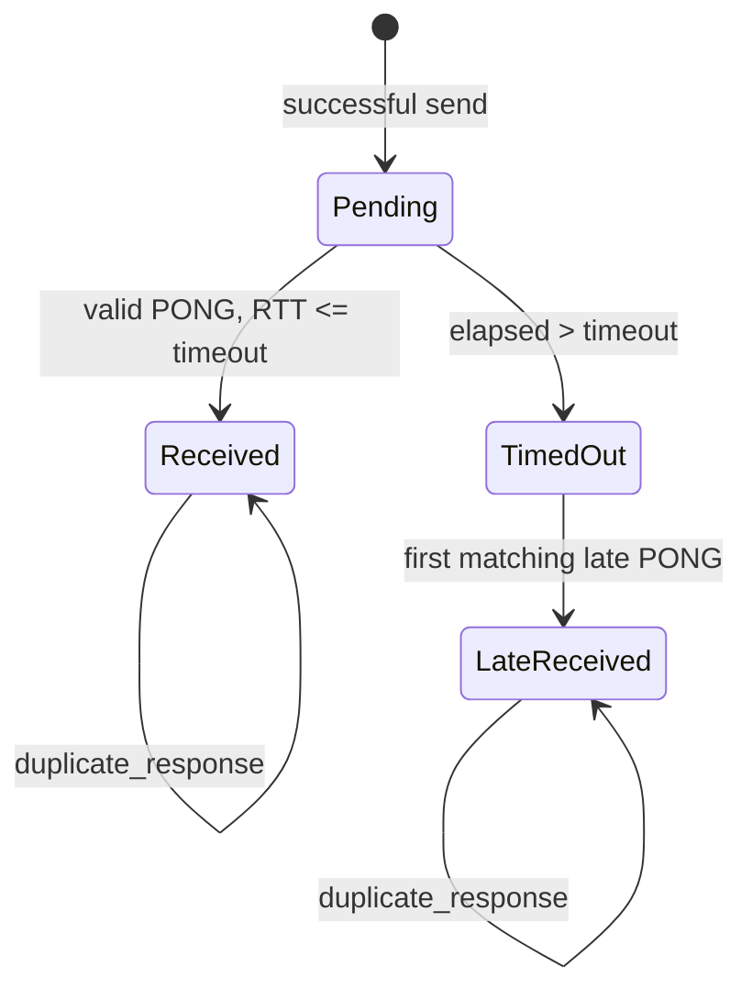

# Спецификация протокола ПР №2

UDP/IPv4, версия 1. Границей пакета служит одна датаграмма. Нельзя объединять пакеты или читать частичную датаграмму как полный пакет. Формат совпадает с учебным шаблоном, но несовместим с ПР №1 Loop.

## Заголовок

| Смещение | Поле | Тип | Размер | Назначение |
|---:|---|---|---:|---|
| 0 | packetType | uint8_t | 1 | 1 PING, 2 PONG, 3 MOVEMENT, 4 SHOOT |
| 1 | sequenceNumber | uint16_t | 2 | Идентификатор измерения |
| 3 | payloadSize | uint16_t | 2 | Размер только полезной нагрузки |
| 5 | protocolVersion | uint16_t | 2 | Всегда 1 |

Всего 7 байт. Все многобайтовые поля big-endian. `PacketHeader` — только модель в памяти: sizeof и выравнивание структуры не определяют wire format. WriteU16/WriteU64 записывают байты сдвигами; ReadU16/ReadU64 проверяют доступную длину перед чтением. Побайтового копирования целых структур в пакеты нет.

## PING и PONG

PING (клиент → сервер): payload 8 байт — `clientSendTimeUs:uint64_t`; общий размер 15 байт.

PONG (сервер → клиент): payload 24 байта — исходная `clientSendTimeUs`, `serverReceiveTimeUs`, `serverSendTimeUs`, каждое поле uint64_t; общий размер 31 байт. sequence и clientSendTimeUs точно повторяют исходный PING.

Метки измеряются в микросекундах источником `std::chrono::steady_clock`. Клиент берёт метку перед сериализацией/отправкой и сохраняет её после успешного sendto. RTT включает сериализацию, системные вызовы, обработку и ожидание на сервере; это прикладное RTT. Сервер ставит receive-метку после recvfrom, send-метку перед сериализацией фактически отправляемого PONG. Часы разных машин не синхронизируются.

`RTT_ms = (clientReceiveUs − savedClientSendUs) / 1000`. Межмашинные разности времени запрещены: серверные метки используются только для диагностического `serverSendUs − serverReceiveUs`. Клиент дополнительно проверяет монотонный порядок серверных меток.

Пример PING: sequence=0x1234, timestamp=0x0102030405060708:

```text
01 12 34 00 08 00 01 01 02 03 04 05 06 07 08
```

MOVEMENT/SHOOT: сервер проверяет общий заголовок и длину payload (8/12 байт), затем логирует команду без расчётов телеметрии и без игрового ответа. Их payload в этом стенде непрозрачен; для переноса игровой логики ПР №1 потребуется отдельный согласованный контракт полей. Клиент измерений отправляет только PING.

## Валидация и причины отказа

| Причина | Проверка |
|---|---|
| truncated_header | null/пустой буфер или длина меньше 7 |
| unknown_type | Тип не входит в 1..4 |
| wrong_type | Клиент ожидает PONG, сервер в PING-обработчике ожидает PING |
| unsupported_version | protocolVersion !=1 |
| invalid_payload_length | payloadSize не соответствует типу либо размер датаграммы !=7+payloadSize |
| foreign_endpoint | Ответ пришёл не от настроенного IPv4 и UDP-порта |
| server_time_order | serverSendTimeUs меньше serverReceiveTimeUs |
| invalid_response | Номер известен, но echoed clientSendTimeUs не совпала либо клиентское receive-время меньше send-времени |

Разбор не читает за границами, не меняет outHeader при неуспехе и возвращает отсутствие результата. Неверный пакет логируется без падения процесса и не завершает ожидающее измерение. Ошибки транспорта выделены отдельно от тайм-аута ожидания. CRC и шифрование в wire format ПР №2 не добавлялись: версия/длины/метки не являются криптографической аутентификацией.

## Жизненный цикл измерения

Запись хранит sequence, sentAtUs, experimentId, sample, state, attempts=1. Реестр вместе с историей ограничен 1024 записями. При заполнении вытесняется старейшая завершённая запись; активная не вытесняется. Если завершённых нет — регистрация отклоняется и клиент заканчивает работу с ошибкой. После вытеснения ответ получает unknown_response. Политика задана количеством, а не обещанием бесконечно распознавать дубли.



Если первый поздний PONG обнаружен до сканирования дедлайнов, telemetry атомарно выдаёт timeout и late_response. Timeout учитывается ровно один раз и поздним ответом не отменяется. Повторный ExpireOverdue не увеличивает потери. Неизвестные/неверные ответы не меняют успешные метрики.

Нельзя повторно занять активный sequence. Завершённый номер можно использовать только с более новой меткой времени; PONG сопоставляется по паре sequence+echoed timestamp. Клиент одной серии отправляет максимум 60000 PING без повторения номера, новая серия — новый процесс/сокет и новая Telemetry. Wrap-around и старые ответы проверены модульными тестами.

Первый принятый RTT инициализирует SRTT; следующие обновляют `0.875*SRTT + 0.125*RTT`. Джиттер — среднее `abs(RTT_i−RTT_(i−1))` в порядке приёма успешных уникальных ответов; при числе ответов <2 равен 0. Min/max/mean/median/SRTT при отсутствии успешных ответов отсутствуют, не заменяются нулём. Потери — `100*timeouts/sent`; при sent=0 возвращается 0 по договорённости. В завершённой серии `sent=received+timeouts`; late — подмножество timeouts.

## CSV и завершение

Первые 7 колонок строго из ТЗ: `experiment_id;sample;sequence;sent_at_ms;rtt_ms;srtt_ms;status`. Дополнительные: run_id, event_index, received_at_ms, attempts, server_receive_us, server_send_us. Разделитель `;`, десятичная точка, пустые поля для отсутствующих чисел. Время sent/received в миллисекундах относительно начала серии; серверные диагностические метки в исходных микросекундах.

На отправленное измерение ровно одна итоговая строка received или timeout. Late/duplicate/unknown/invalid могут добавлять строки событий и не увеличивают N_sent. Для unknown sample пуст; для malformed/foreign используется диагностический stderr. RTT/SRTT заполнены только для received. Анализ группирует по experiment_id/run_id и проверяет уникальность terminal sample.

После последнего PING клиент ждёт `timeout + grace` от фактической последней отправки и завершения всех pending. В основном опыте 1000+1200 мс. Пакеты после окончания этого конечного окна не наблюдаются и не могут попасть в журнал. Повторных передач нет.
