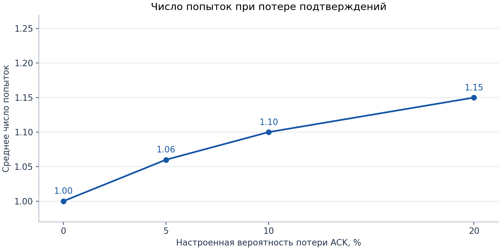
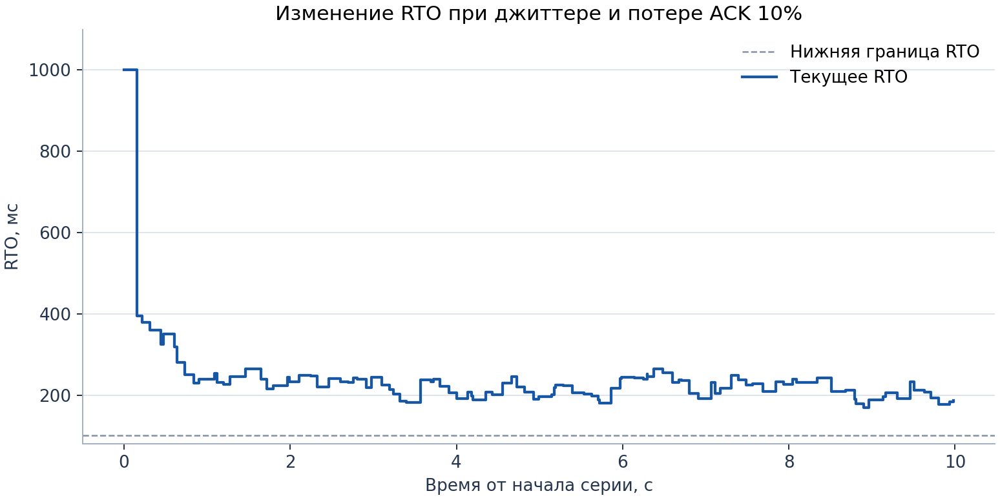

# Отчёт по надёжной доставке поверх UDP


## Архитектура

В Loop выстрел представляет применение оружия или предмета из лутбокса. Его потеря меняет исход эпизода гонки, а повторное применение даёт лишний игровой эффект. Поэтому `SHOOT` передаётся с подтверждением и защитой от повторной обработки. `MOVEMENT` передаёт текущее положение карта. Следующее обновление заменяет предыдущее, и доставка устаревших координат после повторной передачи мешала бы синхронизации. Телеметрические `PING` и `PONG` остаются ненадёжными. Пропущенная проба истекает по правилам ПР №2, а измерения продолжаются на новых пробах.

ПР №3 продолжает лабораторную сборку ПР №2 с отдельными процессами `client` и `server`. В [выделенном сервере Loop](../../README.md#1-проект-и-топология) итог применения предмета определяет сервер. Здесь обработку нового выстрела представляет серверная запись `COMMAND`, а подтверждение означает приём команды сетевым обработчиком. Игровые попадания, повреждения и распространение изменений трассы относятся к серверной логике гонки. См. [игровые механики Loop](../../docs/game-mechanics.md).

### Протокол

В [протоколе версии 2](Protocol_Specification.md) заголовок занимает 8 байт. Он содержит тип (`uint8_t`), `sequenceNumber`, `payloadSize`, `protocolVersion` (по `uint16_t`) и `requiresAck` (`uint8_t`). `SHOOT` указывает `requiresAck=1`. Ответ `ACK` с флагом `0` содержит `acknowledgedSequence` (`uint16_t`), равный номеру `SHOOT`. Тот же номер дублируется в заголовке ответа. Полный размер `SHOOT` равен 20 байтам, а `ACK` — 10 байтам. Числа записываются в порядке big-endian. Парсер проверяет тип, версию, длину и флаг, а у `ACK` сверяет оба номера.

### Отправка и повтор

1. Клиент присваивает новой команде номер, отправляет её и регистрирует байты исходной датаграммы в [`ReliableChannel`](../include/reliability/reliable_channel.hpp). Модуль хранит первую и последнюю метки отправки, счётчик попыток и даёт клиенту список готовых повторов. За сетевой ввод-вывод отвечает клиентский цикл.
2. Сервер проверяет команду и сверяет номер с окном последних 1024 номеров для адреса и порта клиента. Новый номер даёт одно событие `COMMAND`. Дубль получает новый `ACK`, что позволяет восстановиться после потери предыдущего подтверждения. Номер за пределами окна фиксируется как `STALE`. Сравнение по модулю 65536 учитывает переход от 65535 к 0.
3. По принятому `ACK` клиент удаляет запись из `pending`. Повторное подтверждение на уже закрытую запись игнорируется. При отсутствии `ACK` по истечении RTO клиент повторно отправляет те же байты с тем же номером. Максимум пять отправок включает исходную датаграмму, поэтому допустимы четыре повтора.
4. После истечения RTO последней попытки клиент фиксирует `failed` и сообщение `SHOOT not confirmed`. Для игрока это неподтверждённое действие. Сервер мог уже применить выстрел, а подтверждение могло потеряться. Авторитетное состояние сервера определяет окончательный игровой результат.

Окно защищает от дублей в рамках серверного процесса и UDP-адреса клиента. Оно учитывает доставку в изменённом порядке, пока номер команды входит в окно. Подтверждение фиксирует приём отдельной команды, поэтому порядок применения разных выстрелов зависит от порядка их получения.

Стенд хранит до 4096 окон до завершения серверного процесса. В полноценной гонке срок жизни окна должен совпадать со сроком жизни игровой сессии, чтобы машина с повторно использованным UDP-портом получила новое окно при подключении.

### Адаптивный RTO

`RTT` измеряется на клиентских монотонных часах от отправки запроса до ответа. `SRTT` — сглаженный RTT на основе той же функции ПР №2 с `α=0,125`. `RTTVAR` — сглаженная величина отклонения замеров от прежнего `SRTT`. [`AdaptiveTimeout`](../include/reliability/adaptive_timeout.hpp) обрабатывает RTT от принятых `PONG` и `ACK` до первого повтора. По правилу Карна `ACK` после повтора закрывает команду, но его время входит только в метрику времени до подтверждения. Оно может относиться к исходной или повторной датаграмме.

- Стартовый `RTO = 1000 мс`, пока измерений ещё нет.
- При первом измерении `SRTT = RTT`, `RTTVAR = RTT / 2`.
- Далее `RTTVAR = 0,75 × RTTVAR + 0,25 × |предыдущий SRTT − RTT|`.
- После `RTTVAR` обновляется `SRTT = 0,875 × SRTT + 0,125 × RTT`.
- `RTO = clamp(SRTT + 4 × RTTVAR, 100 мс, 3000 мс)`.

Коэффициент 4 даёт запас на заметные колебания времени ответа. При замерах 100 и 120 мс после второго замера получаются `SRTT = 102,5 мс`, `RTTVAR = 42,5 мс` и `RTO = 272,5 мс`. Полученный RTO применяется при очередной проверке срока неподтверждённых пакетов.

## Методика эксперимента

Основной прогон выполнен 15 ноября 2026 года с 16:55:31 до 16:56:34 по Москве. Сборка Release x64, C++17, MSVC 19.51.36256, Windows 11 (26200), CMake 4.4.3. Анализ выполнен на Python 3.12.14 и Matplotlib 3.10.7.

Два процесса обменивались реальными UDP-датаграммами на одном ПК через `127.0.0.1:27015`. В каждой серии отправлялось 100 уникальных команд `SHOOT` с шагом 100 мс. В фоне клиент отправлял `PING` с интервалом 500 мс. Лимит — пять попыток. Стенд применял задержку и пропуски к исходящим `ACK` и `PONG` на пути от сервера к клиенту. Путь `SHOOT` и `PING` до сервера работал с обычным loopback без заданных потерь.

Каждую серию сервер начинал с seed `20261031`. Для `ACK` и `PONG` использовались отдельные экземпляры `xorshift32`, следовавшие одной псевдослучайной последовательности. Число проб `PING` не сдвигает последовательность решений для `ACK`. Повторы `SHOOT` получают новые решения о пропуске ответа. Случайные решения при одинаковом порядке пакетов воспроизводимы, а фактическое время прихода зависит от планировщика и UDP-стека.

| Серия | Задержка ответа | Вероятность пропуска ответа |
|---|---:|---:|
| `baseline` | 0 мс | 0% |
| `loss_5` | 0 мс | 5% |
| `loss_10` | 0 мс | 10% |
| `loss_20` | 0 мс | 20% |
| `delay_100_loss_5` | 100 мс | 5% |
| `jitter_loss_10` | целое равномерное значение от 50 до 150 мс | 10% |

Исходные данные хранятся в [reliability_samples.csv](reliability_samples.csv). Идентификатор запуска отделяет события разных серий. `sent` и `retransmit` отмечают исходную и повторную отправку, `acknowledged` и `failed` — её итог, `pong_sample` — принятый замер ПР №2, `final` — конечное значение RTO. `at_ms` — время от старта данной серии. Записи `acknowledged` содержат время от исходной отправки до подтверждения.

## Результаты

Доли рассчитаны от числа исходных `SHOOT`. ACK с первой попытки означает, что подтверждение пришло до первой повторной отправки. Среднее число попыток включает все команды, включая `failed`. Средний RTO рассчитан по текущему значению в момент каждого исхода команды. Среднее время до ACK рассчитано по подтверждённым командам.

| Серия | Отправлено | ACK с 1-й попытки | Повторы | Failed | Ср. попыток | Ср. RTO, мс | RTO в конце, мс | Ср. время до ACK, мс |
|---|---:|---:|---:|---:|---:|---:|---:|---:|
| `baseline` | 100 | 100 (100.0%) | 0 | 0 (0.0%) | 1.00 | 100.00 | 100.00 | 0.30 |
| `loss_5` | 100 | 94 (94.0%) | 6 | 0 (0.0%) | 1.06 | 100.00 | 100.00 | 6.88 |
| `loss_10` | 100 | 92 (92.0%) | 10 | 0 (0.0%) | 1.10 | 100.00 | 100.00 | 11.18 |
| `loss_20` | 100 | 87 (87.0%) | 15 | 0 (0.0%) | 1.15 | 100.00 | 100.00 | 17.03 |
| `delay_100_loss_5` | 100 | 93 (93.0%) | 7 | 0 (0.0%) | 1.07 | 117.60 | 110.74 | 116.54 |
| `jitter_loss_10` | 100 | 91 (91.0%) | 10 | 0 (0.0%) | 1.10 | 227.45 | 186.18 | 130.98 |

## Графики





## Анализ

**Влияние задержки на RTO.** В сериях без добавленной задержки оценка опустилась до нижней границы 100 мс. При фиксированной задержке 100 мс итоговый RTO составил 110,74 мс. В серии с джиттером таймер стартовал с 1000 мс, снижался по мере появления замеров, менялся вместе с их разбросом и завершил серию на 186,18 мс. Фиксированный порог 1000 мс из ПР №2 используется для истечения измерительной пробы. При таком же пороге для `SHOOT` клиент ожидал бы секунду перед первым повтором даже на быстром локальном соединении.

**Серия `loss_20`.** Сервер пропустил 15 из 115 возможных ACK, то есть около 13,0% при заданной вероятности 20%. Наблюдаемая доля зависит от конечной выборки и seed. 87 команд подтвердились с первой попытки, остальные 13 потребовали суммарно 15 повторов. Все команды подтвердились в пределах лимита, поэтому `failed = 0`. При модели независимых пропусков с вероятностью 20% вероятность пропуска всех пяти подтверждений была бы `0,2⁵ = 0,032%` на команду. Ветку окончательного отказа отдельно проверяют автоматические тесты.

**Повторы и игровой эффект.** Клиент отправил 600 исходных команд и 48 повторов, а сервер зафиксировал 600 новых выстрелов и 48 дублей. Для каждого повтора сервер проверил номер в окне, сформировал подтверждение с учётом профиля эмулятора и сохранил уже применённый эффект без изменений. В серии `delay_100_loss_5` сервер пропустил 6 ACK, а клиент сделал 7 повторов. Дополнительная попытка показывает, что время ожидания может истечь и при задержанном ответе.

## Вывод

В шести сериях лимит повторов обеспечил подтверждение всех 600 выстрелов. Окно сервера ограничило каждую команду одним вызовом игровой обработки при 48 повторных датаграммах. Параметр RTO использовал замеры ПР №2 и подтверждения выстрелов, поэтому ожидание зависело от задержки и её разброса в текущей серии.

## Воспроизведение

Команды для Windows из каталога `pr2-latency-template`. Для одноконфигурационной сборки `--bin-dir` указывает на `build`.

```powershell
cmake -S . -B build
cmake --build build --config Release --parallel
ctest --test-dir build -C Release --output-on-failure
python -m pip install -r scripts/requirements.txt
python scripts/run_reliability_experiments.py --bin-dir build/Release --output-dir build/reliability-repeat
```

Скрипт запускает серии последовательно, ждёт привязки сокета у сервера и сверяет попытки, финальные исходы и метки из CSV. По серверному журналу он проверяет, что каждый подтверждённый `SHOOT` применён ровно один раз. Для следующего прогона используйте новый `--output-dir`.

## Проверка кода

Локальная проверка Release прошла по всем трём группам CTest, включая обмен UDP. Catch2 выполнил 24 тестовых сценария.

| Участок | Проверка |
|---|---|
| Протокол | Флаг соответствует типу, длина совпадает с полезной нагрузкой, два номера в ACK совпадают. |
| Повторы | Новая попытка доступна после RTO, дубли ACK игнорируются, после последней попытки остаётся полный срок ожидания. |
| Таймер | RTT после повтора исключается из расчёта, PONG проходит проверку телеметрии, RTO ограничен заданным диапазоном. |
| Сервер | Повтор получает ACK без второго вызова обработки. Один и тот же номер от двух адресов и портов обрабатывается отдельно. |
| Результаты | Для каждой исходной команды сверены попытки и итог, а число обработок сверено по журналу сервера. |

Локальная ветка — `feature/reliable-delivery`. Описание Pull Request, задачи для трекера и пункты для ревью собраны в [материалах для сдачи](Reliability_Submission.md).
